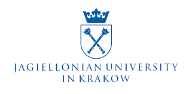
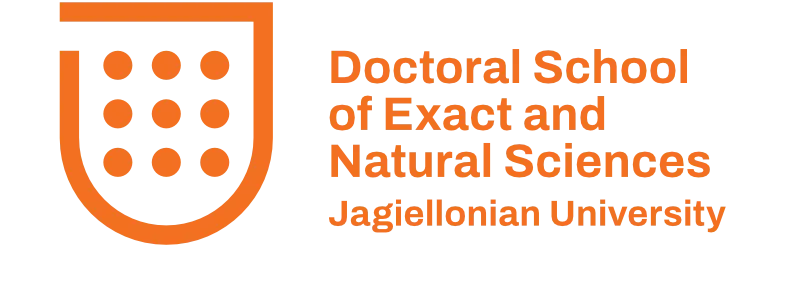

::: {.hero}
::: {.hero-text}
<h1 class="hero-title">Deep Learning for Scientific Discovery</h1>

A doctoral course at the Jagiellonian University in Kraków

For the Doctoral School of Exact and Natural Sciences · winter semester 2026/2027

Neural networks from first principles, trained on real scientific data: images of blood cells and of the Earth's surface, spin configurations of a magnet, and the landmark discoveries made with deep learning in biology, mathematics, materials science and physics.

<a href="https://chaos.if.uj.edu.pl/marcinplodzien/"><b>Marcin Płodzień</b></a> · Atomic Optics Department, Institute of Theoretical Physics, Jagiellonian University in Kraków

[Start with Lecture 1](lectures/lecture-01.qmd){.btn .btn-primary} [Browse the lectures](#lectures){.btn .btn-outline-primary} [Course flyer (PDF)](assets/course-flyer.pdf){.btn .btn-outline-primary}
:::

::: {.hero-image}
{fig-alt="Spin configurations of the 2D Ising model below, at and above the critical temperature"}
:::
:::

## The course

The course is for doctoral students of physics, mathematics, chemistry, biology and geography. Each lecture comes with its slides and with Jupyter notebooks that reproduce every figure and number on the slides. The notebooks run on a laptop CPU or in Google Colab; each page has an *Open in Colab* button.

## Lectures {#lectures}

| | Lecture | Notebooks |
|---|---|---|
| 1 | [AI, Machine Learning and Scientific Discovery: Paradigms and Applications](lectures/lecture-01.qmd) | Labs 001–003: Python, NumPy, PyTorch |
| 2 | [Supervised Learning: the Recipe of Deep Learning](lectures/lecture-02.qmd) | Labs 004–009: automatic differentiation, universal approximation, training, MNIST |
| 3 | [Supervised Learning on Images: Convolutional Neural Networks](lectures/lecture-03.qmd) | Labs 013a/b: CNNs in PyTorch and JAX; limits of deep networks |
| 4 | [Supervised Learning on Scientific Images: CNNs, Transfer Learning, Ising Model](lectures/lecture-04.qmd) | blood cells, satellite images, transfer learning (Labs 014a/b), the Ising model, Labs 010–012 |
| 5 | [Unsupervised Learning I: Dimensionality Reduction, Clustering, Autoencoders](lectures/lecture-05.qmd) | PCA, t-SNE, clustering, autoencoders, anomalies |
| 6 | [Unsupervised Learning II: Probability and Variational Autoencoders](lectures/lecture-06.qmd) | VAE, latent spaces, conditional generation, β-VAE, Ising configurations, galaxies, Lab 015: trajectories |
| 7 | [Time Series: Linear Models, Neural Networks and Neural ODEs](lectures/lecture-07.qmd) | delay embedding, AR, MA, ARMA, NVAR, MLP, RNN, LSTM, neural ODEs, PINNs; sunspots, weather; exercises on the S&P 500 and El Niño |

## Main reading

- T. Heightman, M. Płodzień, *Deep Learning in Classical and Quantum Physics*, Springer (to appear, 2027), [arXiv:2508.10666](https://arxiv.org/abs/2508.10666)
- A. Dawid, J. Arnold, …, M. Płodzień et al., *Machine Learning in Quantum Sciences*, Cambridge University Press (2025), [arXiv:2204.04198](https://arxiv.org/abs/2204.04198)
